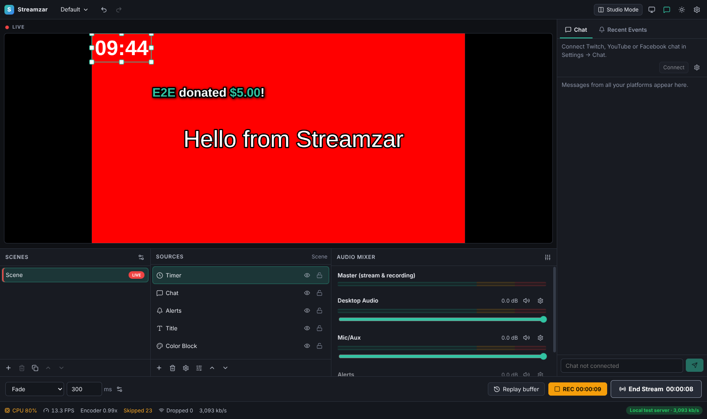

# Streamzar

A free, open-source live streaming studio — a Streamlabs-style desktop app built from scratch.
Build scenes from your camera, screen, games, images, videos, web overlays and widgets, then go
live on **YouTube, Facebook, Twitch, Kick, TikTok, X, Instagram, LinkedIn, Trovo, Rumble** or any
RTMP/SRT server — **on several platforms at the same time** — while recording in high quality.



## Features

| Area | What you get |
| --- | --- |
| **Scenes & sources** | Unlimited scenes and scene collections, drag-and-drop ordering, nested scenes, sources shared between scenes, copy/paste, duplicate, undo/redo (Ctrl+Z / Ctrl+Y), import/export of collections. |
| **Sources** | Video capture device (webcam / capture card), display capture, window / game capture, audio input (mic), desktop audio, image (incl. animated GIF/WebP/APNG), image slideshow, media file (video/audio), text (outline, shadow, read from file), color block, browser source (any URL / overlay, transparent, optional page audio). |
| **Widgets** | Alert Box (image/GIF/video, sound, animations, templates), Chat Box (all platforms merged, emotes), Event List, Goal bar (auto-updates from events), Timer / Countdown / Clock / Stream uptime, Stream Labels (latest follower, top donation, session totals, viewer count…). |
| **Editor** | Drag, resize (aspect-locked corners, Shift = free), rotate (Shift = 15° steps), Alt-drag to crop, snapping to edges/centre/other sources (Ctrl to bypass), arrow-key nudging, fit / stretch / fill / center / flip / rotate presets, numeric Edit Transform dialog. |
| **Video filters** | Chroma key (green screen), color key, color correction, blur, sharpen, pixelate, scroll, image mask/blend, 3D LUT (.cube). All GPU-accelerated. |
| **Audio mixer** | Per-source faders, mute, stereo peak/RMS meters with peak hold, monitoring (off / monitor only / monitor & output) to a chosen device, sync offset, balance, mono downmix, filters: noise gate, compressor, limiter, 3-band EQ, high-pass, gain; WebRTC noise suppression / echo cancellation / AGC for mics. Global Desktop Audio & Mic/Aux. |
| **Studio mode & transitions** | Edit a preview scene and send it to program with Cut, Fade, Fade to color, Slide, Swipe, Zoom, Luma wipe (6 patterns) or Stinger (video) transitions. |
| **Go Live / multistream** | One encode sent to every enabled destination at once; per-destination status, bitrate and dropped frames; automatic reconnect with back-off; congestion handling that drops whole GOPs instead of corrupting the stream; optional stream delay (with graceful drain). |
| **High quality encoding** | FFmpeg with x264 or hardware encoders (NVIDIA NVENC, Intel QuickSync, AMD AMF, Apple VideoToolbox, VA-API) — only encoders that pass a test on your machine are offered. CBR / VBR / constant quality, presets, profiles, B-frames, 2 s keyframes, up to 4K60. High-quality GPU downscaling (bilinear / bicubic / Lanczos) and exact BT.709 color conversion. |
| **Recording & replays** | Record to MP4, fragmented MP4 (crash-safe), MKV, MOV, FLV or TS — sharing the stream encoder or with separate higher quality (incl. HEVC). Replay buffer ("save the last 30 s"), screenshots, MKV→MP4 remux tool. |
| **Chat & events** | Unified chat panel: Twitch (anonymous or with OAuth to send), YouTube Live Chat (API key; OAuth to send), Facebook live comments. Twitch subs/resubs/gift subs/bits/raids, YouTube Super Chats/Super Stickers/memberships trigger alerts automatically. Recent events panel with replay. |
| **Integrations** | Local webhook (`POST /api/alert`) for any donation tool, built-in Ko-fi webhook, phone remote control page (scenes, mute, volume, go live, record, replay, studio transition). |
| **Other** | Global hotkeys (work in games) for everything incl. per-scene switching and per-source mute, windowed / full-screen projectors, dark & light theme, stats bar (CPU, FPS, encoder speed, skipped & dropped frames, bitrate). |

## Quick start: go live on YouTube and Facebook

1. Install and open Streamzar. A *Desktop Audio* and *Mic/Aux* source already exist.
2. In **Sources**, click **+** and add what you want to show (e.g. *Display Capture* or *Window / Game Capture*, *Video Capture Device* for your webcam, an *Alert Box*…).
3. Click **Go Live** (right-click it to open the full dialog) and add your destinations:
   - **YouTube** – YouTube Studio → *Create → Go live → Stream* → copy the **Stream key**.
     Streamzar uses YouTube's secure RTMPS ingest by default.
   - **Facebook** – *Live video → Streaming software* → copy the persistent **Stream key**.
   - Add as many platforms as you like (Twitch, Kick, TikTok, …) and switch on the ones to use.
4. Pick a quality in **Settings → Output** (quick presets) and press **Go Live**.

Stream keys and tokens are stored encrypted with your operating system's keychain.

### Recommended quality

| Upload speed | Setting |
| --- | --- |
| ≥ 12 Mbps | 1080p 60 fps, 9 000 kbps (YouTube; Facebook/Twitch work best ≤ 6 000–8 000 kbps) |
| ≥ 8 Mbps | 1080p 30 fps, 6 000 kbps |
| ≥ 6 Mbps | 720p 60 fps, 6 000 kbps |
| < 6 Mbps | 720p 30 fps, 3 000–4 000 kbps |

When multistreaming, all destinations share one encode, so the total upload is *bitrate × number
of destinations*. Prefer a hardware encoder (NVENC / QuickSync / AMF / VideoToolbox) when gaming.
Keep the keyframe interval at 2 s (required by YouTube, Facebook and Twitch).

## Build & run from source

Requirements: Node.js 22+. FFmpeg is bundled automatically (`ffmpeg-static`).

```bash
npm install
npm run build
npm start
```

Development (rebuilds on change; press Ctrl+R in the app to reload the UI):

```bash
npm run dev      # terminal 1
npm start        # terminal 2
```

Create installers (run on the target OS — each OS gets its own FFmpeg binary):

```bash
npm run dist     # Windows: NSIS .exe · macOS: .dmg · Linux: AppImage + .deb
```

The GitHub Actions workflow in `.github/workflows/build.yml` runs all tests and builds installers
for Windows, macOS and Linux on every push; download them from the run's *Artifacts*.

## Tests

```bash
npm run typecheck          # TypeScript (main, preload, renderer)
npm test                   # unit tests
npm run test:integration   # real FFmpeg: RTMP streaming, reconnect, delay, recording, replay, every format/encoder argument
npm run build && xvfb-run -a node test/e2e/run.mjs   # drives the real Electron app end to end
```

The end-to-end test builds a scene through the UI, records and streams to a local RTMP server,
and checks the result with ffprobe — including that the encoded pixels have the right colours.

## Platform notes

- **macOS**: allow Streamzar under *System Settings → Privacy & Security* for *Camera*,
  *Microphone* and *Screen & System Audio Recording* (needed for display/window capture and
  desktop audio on macOS 13+).
- **Linux**: desktop audio uses the PulseAudio/PipeWire *“Monitor of …”* device. If none is listed,
  enable one (e.g. with `pavucontrol`) or add it as an *Audio Input Capture*.
- **Games**: use *Window / Game Capture*. Games in exclusive full-screen mode may need borderless or
  windowed mode to be captured.
- **Follower alerts** require platform webhooks: send them (or any donation) to the local webhook
  shown in *Settings → Remote & Webhooks*.

## How it works

```
Renderer (UI process)                               Main process
┌────────────────────────────────────────┐          ┌──────────────────────────────────────────────┐
│ Sources (camera, screen, media, web,   │          │ MediaHub ── raw Matroska ──► FFmpeg encoder   │
│ widgets) ─► WebGL2 compositor           │  raw     │                (x264/NVENC/QSV/AMF/VT)       │
│   filters, transitions, studio mode     │  I420 +  │                    │ encoded Matroska         │
│   GPU scale + BT.709 RGB→I420 packing ──┼─ PCM ───►│                    ▼                          │
│ WebAudio mixer ─► capture worklet ──────┼─ TCP ───►│  StreamFanout ─┬─► Pusher (RTMP/RTMPS/SRT) ×N │
│ (shared audio clock timestamps)         │          │   (keyframe-   ├─► Recorder (MP4/MKV/…)       │
└────────────────────────────────────────┘          │    aligned)    ├─► Replay buffer              │
                                                     │                └─► Stream delay buffer        │
                                                     └──────────────────────────────────────────────┘
```

Video is encoded **once**; every destination, the recording and the replay buffer reuse the same
encoded stream (unless you choose a separate recording quality). A destination that disconnects is
re-attached at the next keyframe, so the others never notice.

## License

Streamzar is MIT licensed (see `LICENSE`). The bundled FFmpeg binary (from the `ffmpeg-static`
package) is licensed separately under the GPL; its license and source information are installed
next to the binary (`ffmpeg.LICENSE`, `ffmpeg.README`).
